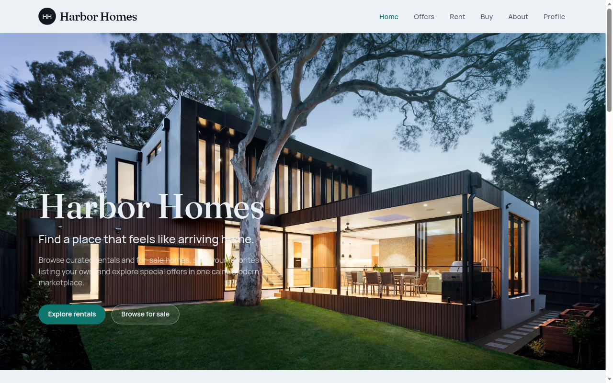
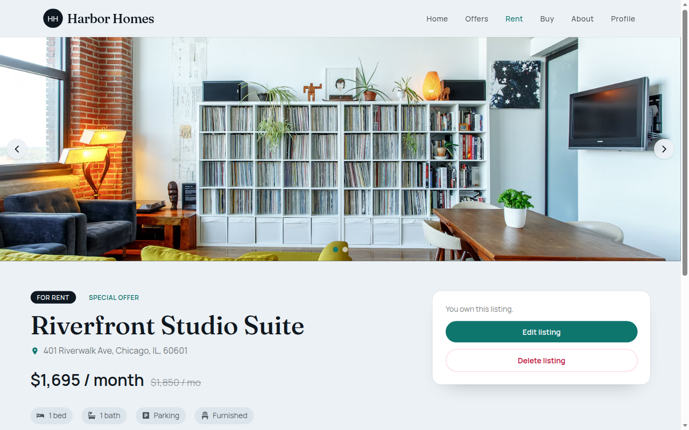
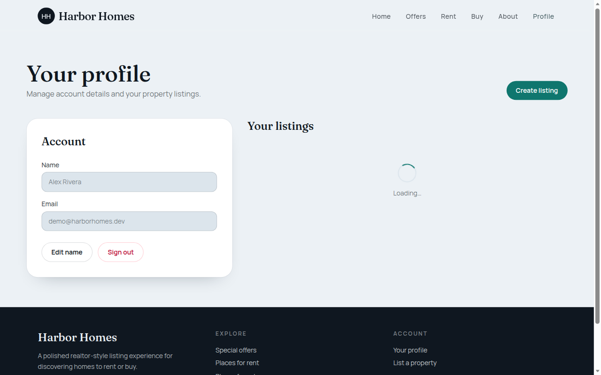
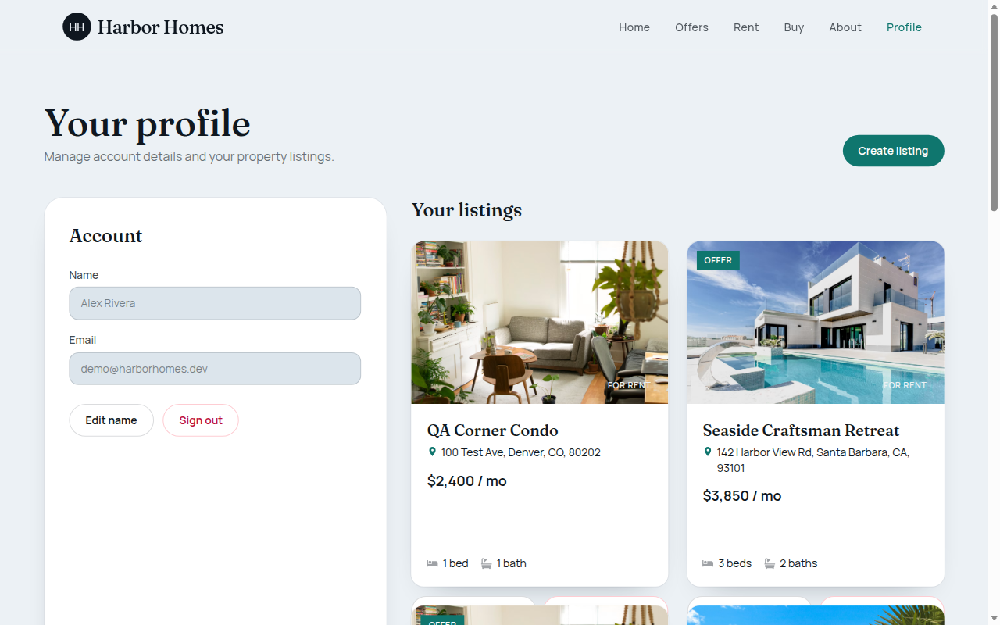
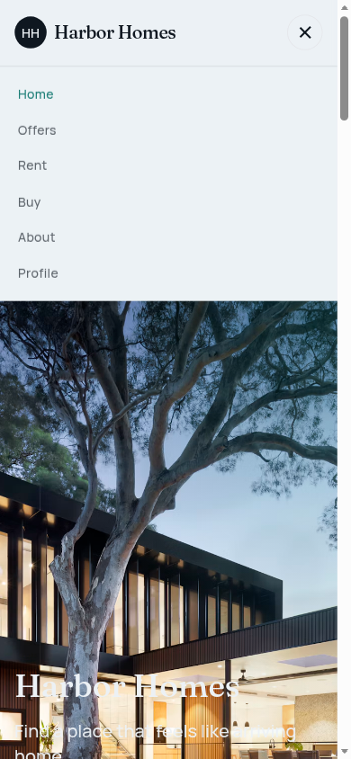

# Harbor Homes — Realtor Clone (React + Tailwind)

A polished realtor-style property listing app built as a portfolio-ready Create React App project. Browse homes for rent or sale, sign in, and manage full listing CRUD — all persisted in the browser with localStorage (no backend required).

## Features

- Home feed with hero, recent offers, rentals, and for-sale sections
- Category pages for rent / sale plus a dedicated Offers page
- Listing detail with image slider, amenities, contact CTA, and owner actions
- Auth flows: register, sign in, forgot password, protected profile
- Create / edit / delete listings with validation and loading / empty / error states
- Responsive layout (mobile + desktop) with sticky navigation

## Tech stack

- React 18 + Create React App
- React Router v6
- Tailwind CSS 3
- react-toastify, react-icons, uuid
- Prettier + ESLint (react-app + prettier)
- GitHub Actions CI (lint, format check, tests, build)

## Screenshots

| Home                           | Listing detail                      |
| ------------------------------ | ----------------------------------- |
|  |  |

| Offers                     | Profile                      |
| -------------------------- | ---------------------------- |
|  |  |

| Mobile                               |
| ------------------------------------ |
|  |

## Demo credentials

| Field    | Value                  |
| -------- | ---------------------- |
| Email    | `demo@harborhomes.dev` |
| Password | `demo1234`             |

Seed listings are loaded automatically on first visit.

## Setup

```bash
npm install
cp .env.example .env   # optional
npm start
```

Open [http://localhost:3000](http://localhost:3000).

### Scripts

| Command                | Description      |
| ---------------------- | ---------------- |
| `npm start`            | Dev server       |
| `npm run build`        | Production build |
| `npm test`             | Jest (watch)     |
| `npm run test:ci`      | Jest once (CI)   |
| `npm run lint`         | ESLint           |
| `npm run format`       | Prettier write   |
| `npm run format:check` | Prettier check   |

## Environment variables

Copy `.env.example` to `.env` if you want to customize the site name:

```bash
REACT_APP_SITE_NAME=Harbor Homes
```

No API keys are required. Auth users and listings are stored in `localStorage` under the `harborhomes.*` keys.

## Project structure

```
src/
  components/   # Layout, listing cards, form, slider, states
  context/      # Auth + listings providers
  data/         # Seed users & listings
  pages/        # Route screens
  services/     # localStorage helpers
  utils/        # Formatters
```

## License

MIT — portfolio / tutorial demo.
